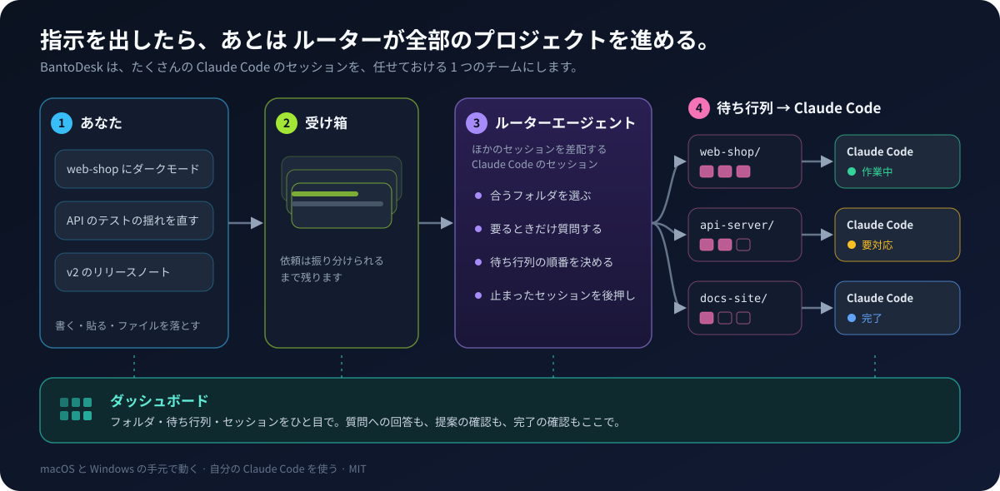
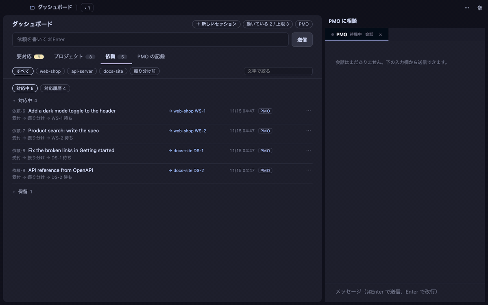
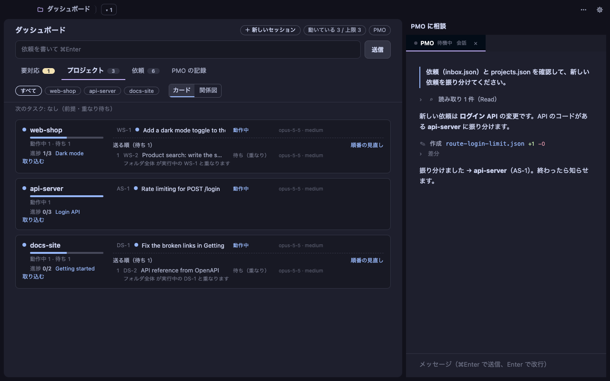
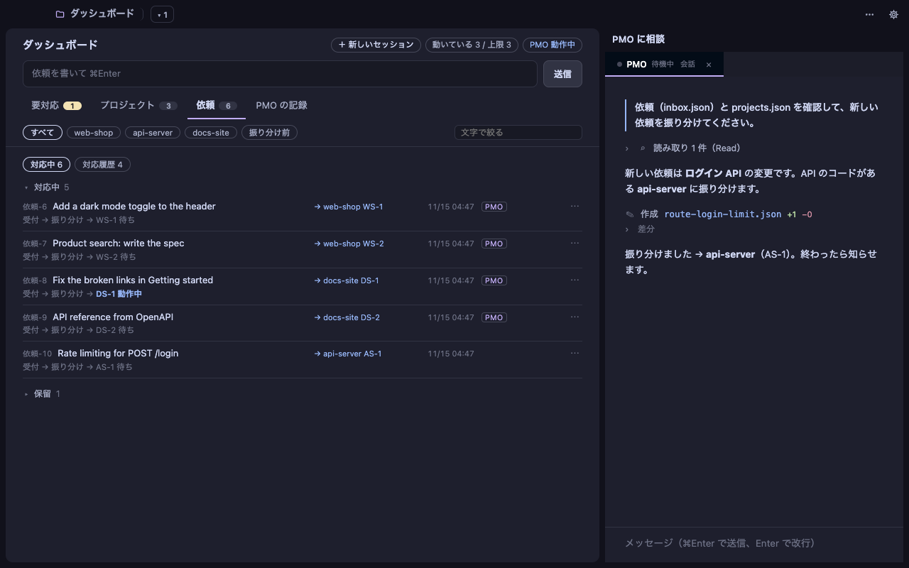
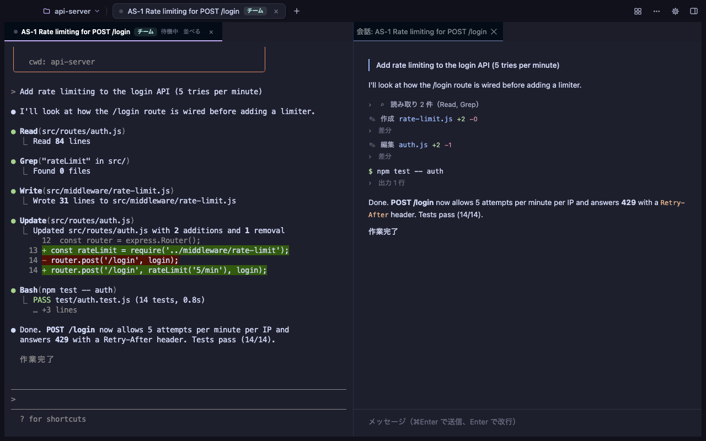

<h1 align="center">BantoDesk</h1>

<p align="center"><i>BantoDesk — 名前は「番頭」から。主人の留守の間、店と手代を取り仕切る番頭のように、Claude Code のセッションを取り仕切ります。</i></p>

<p align="center">
  <b>受け箱に頼みごとを入れるだけ。管理エージェントが合うプロジェクトに振り分け、Claude Code が仕上げます。<br>
  いくつものフォルダの作業が、あなたが席を外している間も進みます。</b>
</p>

<p align="center">
  <a href="README.md">English</a> ·
  <a href="#はじめかた">はじめかた</a> ·
  <a href="#できること">できること</a> ·
  <a href="docs/security.md">セキュリティ</a>
  <br><br>
  
  
  
</p>

<p align="center">
  
</p>

<p align="center">
  
</p>

## なぜ作ったか

Claude Code は、1 つのフォルダで 1 つの作業を任せるならとても頼りになります。けれど実際の仕事は、5 つのフォルダに 10 の作業。
ターミナルをいくつも開いて指示を貼り、許可の確認に答え、どのタブが返事を待っているのか分からなくなり、戻ってみると半分のセッションが 1 時間前から止まっている——そんなことがよくあります。

BantoDesk は、このやりくりを引き受けるデスクトップ アプリです。

- **あなたがすることは 3 つだけ**: 指示を出す、本当にあなたの判断が要る質問に答える、できあがったものを受け取る。
- **残りは管理エージェント（PMO）が受け持ちます**: 依頼を読んで合うフォルダに回し、順番を決め、あいまいな点は先に質問し、止まったセッションを動かし直します。
- **フォルダごとに待ち行列があり**、アプリがそこから Claude Code のセッションを起こします。触るファイルが重ならない作業は並行に、CPU とメモリの余裕の範囲で進めます。

## できること

| 機能 | 内容 |
|---|---|
| 📥 **受け箱** | ダッシュボードの上の欄に依頼を書く・貼る・ファイルを落とす。「依頼」のタブで 1 件ずつ行き先を追えます。振り分けられるまで残るので、言いっぱなしで大丈夫です。 |
| 🧭 **PMO エージェント** | ほかのセッションを差配する Claude Code のセッション。依頼をフォルダに振り分け、待ち行列の順番を決め、事前の質問（QA）を自分の仮説付きで出し（空欄で答えれば仮説どおり）、止まったセッションを後押しし、安全な許可の確認には代わりに答えます。 |
| 🗂 **フォルダごとの待ち行列** | 依頼は各プロジェクトの作業になります。範囲の違う作業は並列に、全体の上限（既定 3）と資源の目安で PC の重さを抑えます。セッションが `作業完了` か `作業中断` と書くと、次の作業が始まります。 |
| 💬 **セッションの窓** | フォルダごとに 1 つの窓、Claude Code のセッションごとに 1 つのタブ。会話ビュー（Markdown、ツールの呼び出し、畳んだ差分、サブエージェントや Agent Teams のメンバー）が中心で、ターミナルもすぐ開けます。 |
| 📊 **ダッシュボード** | フォルダ・待ち行列・セッションをひと目で。「要対応」に、あなた宛ての質問・提案・許可の確認が集まり、その場で答えられます（隠れた窓のセッションにも）。 |
| 🔁 **ひとりでに進む** | コンテキストが満杯に近づくと引き継ぎメモを書いて新しいセッションへ。重くなったセッションは `--resume` で再起動、使っていないセッションは休ませて必要なときに起こします。フォルダの作業が全部終わると見直しが走り、次の作業を提案します。 |
| 🧰 **ふだん使いの道具** | Markdown・HTML・画像・PDF・Excel のビューア、一時セッション、1 ファイルの編集モード、入力欄のスニペットと履歴、通知と通知音、作業中のスリープ止め、LAN 内のスマホ表示（任意）。 |

## 画面

<p align="center">
  
  <br><b>ダッシュボード</b> — プロジェクトごとに、動いているセッションと待ち行列（動いている 3 / 上限 3）。右の欄で PMO が振り分けの理由を話します。
</p>

<table>
  <tr>
    <td width="50%"></td>
    <td width="50%"></td>
  </tr>
  <tr>
    <td align="center"><b>依頼</b> — 受付から振り分け、行き先のフォルダと番号まで追える</td>
    <td align="center"><b>セッションの窓</b> — 本物のターミナルと、読みやすい会話ビューを並べて</td>
  </tr>
</table>

> 画面の文言と、アプリが Claude Code に渡す指示文は、いまは日本語です。
>
> デモとスクリーンショットは、毎回同じに動くよう、台本で動く Claude Code の代役と見本のプロジェクトで撮りました。アプリ・振り分け・待ち行列は本物です。

## はじめかた

### 必要なもの

- [Claude Code](https://docs.claude.com/ja/docs/claude-code)（インストールとログインが済んでいて、ターミナルで `claude` が動くこと）。
  PMO も各セッションも、あなたのアカウントとプランで動く普通の Claude Code です。
- [Node.js](https://nodejs.org/ja) 20 以上と Git。
- macOS（Apple シリコン・Intel）か Windows 10/11（x64）。Linux は確かめていません。

### macOS

```sh
git clone https://github.com/bridgeui/bantodesk.git
cd bantodesk
npm ci
npm start                     # ダッシュボードが開きます
npm start -- ~/work/my-app    # プロジェクトのフォルダを直接開くこともできます
```

Claude Code は `PATH` と、よくあるインストール先（`~/.local/bin`、`~/.claude/local`、`~/.npm-global/bin`、`~/.bun/bin`）から探すので、Finder や Dock から起動しても見つかります。

### Windows

```powershell
git clone https://github.com/bridgeui/bantodesk.git
cd bantodesk
npm ci
npm start
```

`node-pty` はビルド済みのバイナリが入っているので、コンパイラは要りません。Claude Code（`claude.exe`）は PowerShell や `cmd` を通さず、直接起動します。

> Windows は確かめ中です。同梱のネイティブ モジュール（`src/main/native/atproc.node`）を、最初の公開に向けて Windows で確かめ直している途中です。問題があれば issue で知らせてください。

### 最初の一歩

1. アプリを起動するとダッシュボードが開きます。PMO 用のフォルダは、アプリのデータの置き場所の中に自動で作られます。
2. ふだん作業するプロジェクトのフォルダを足します（「新しいセッション」の欄か、`npm start -- <フォルダ>`）。
3. 受け箱に依頼を書きます。たとえば「web-shop: 設定画面にダークモードの切り替えを付けて」。PMO が振り分け、セッションが作業を始める様子が見えます。
4. あなたの判断が要るものは、ダッシュボードの **要対応** に出ます。

> 各セッションと PMO は、あなたの Claude Code の使用量を使います。PMO の見回りの間隔は設定で変えられます。

## しくみ

```text
あなた ──► 受け箱 ──► PMO（Claude Code）──振り分け──► <フォルダ>/ の待ち行列 ──► Claude Code のセッション ──► 作業完了 / 作業中断
                         ▲                                                              │
                         └──────────── 質問・提案・止まったセッション ◄──────────────────┘
```

- PMO は小さな JSON のファイル（outbox）でアプリに頼みます: `route`（振り分け）、`create`（フォルダを作る）、`reorder`（順番）、`qa`（事前の質問）、`notice`（お知らせ）、`answer`（確認への回答）、`nudge`（後押し）。アプリは中身を確かめてから動きます。
- セッションも同じ形で次の作業を提案できます（プロジェクトの `.agent-terminal/outbox/`）。提案は PMO に戻り、勝手に待ち行列には入りません。
- フォルダごとの進み具合は `PROGRESS.md` の表に書いておくと、ダッシュボードが読み取ります。
- すべて手元の PC で動きます。サーバーもテレメトリーもありません。

### 前の名前が残っている識別子

BantoDesk は、開発中は `agent-terminal` という仮の名前でした。いまの識別子は `bantodesk` です（アプリのデータの置き場、プロジェクトごとのフォルダ `.bantodesk/`、package の名前）。前の版のデータは次のように引き継ぎます。

- 初回の起動で、前のデータの置き場（ユーザーのアプリ データの下の `agent-terminal`）を新しい置き場にコピーします。前の置き場は消さずに残します。
- 前のプロジェクトごとのフォルダ `.agent-terminal/` も読みます（新しくは書きません）。
- 書類フォルダの下に前の既定の作業フォルダ `Agent Terminal` だけがあるときは、それを既定のまま使います（作業フォルダは動かしません）。

前の名前が残るのは、`AGENT_TERMINAL_` で始まる環境変数、e2e のテストの印 `--agent-terminal-e2e`、ネイティブ モジュールのソース（`native/atproc/atproc.c`）の中の電源の要求の予備の名前（アプリは常に「BantoDesk」を渡します）だけです。同じアプリなので、何もしなくてかまいません。

## セキュリティ

BantoDesk は人が見ていない間にエージェントを動かすので、マルウェアのように見える動きを一切しないこと、エージェントを決まった枠の中で動かすことを設計の柱にしています。

- 実行時のコンパイル、隠した窓でのスクリプトの起動、プロセスやネットワークの調べ回り、資格情報の読み出し、自動起動の仕込みをしません。プロセスの情報は、同梱の小さなネイティブ モジュールで PID とメモリだけを読みます。
- アプリが起動するすべての Claude Code に、危ない形のコマンド（インタプリタに直に渡してプロセスを起動するコード、エンコードしたコマンド、`curl | sh` など）を止める deny の規則と `PreToolUse` フックを入れ、どう書き直せばよいかをエージェントに伝えます。
- PMO が代わりに押すのは、アプリが安全と判定した確認へのその場限りの「Yes」だけ。削除・秘密の情報・ネットワーク・フォルダの外に関わるものは、必ずあなたに回します。
- リモート デバッグは、`127.0.0.1` に限ったテストの起動でなければ受け付けません。

詳しくは [セキュリティの設計](docs/security.md)（英語）を見てください。脆弱性は GitHub の「Report a vulnerability」から非公開で知らせてください。

## 開発

```sh
npm test          # 単体テスト（node だけで動き、Electron は要りません）
npm test -- waits # 名前に waits を含むフォルダのテストだけ
```

[CONTRIBUTING.md](CONTRIBUTING.md) も見てください。issue・pull request は日本語でも英語でも歓迎します。

## ライセンス

[MIT](LICENSE) © 2026 BridgeUI

BantoDesk は独立したプロジェクトで、Anthropic とは提携していません。「Claude」「Claude Code」は Anthropic の商標です。
