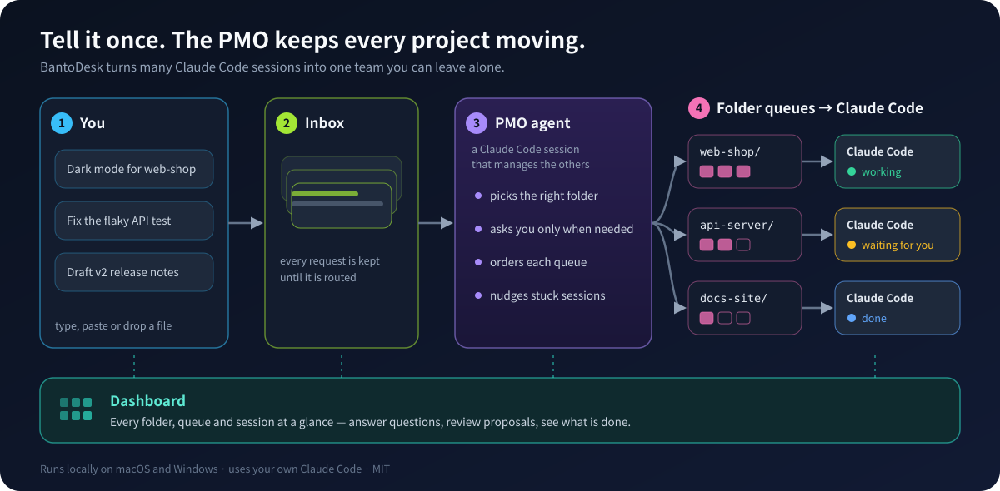
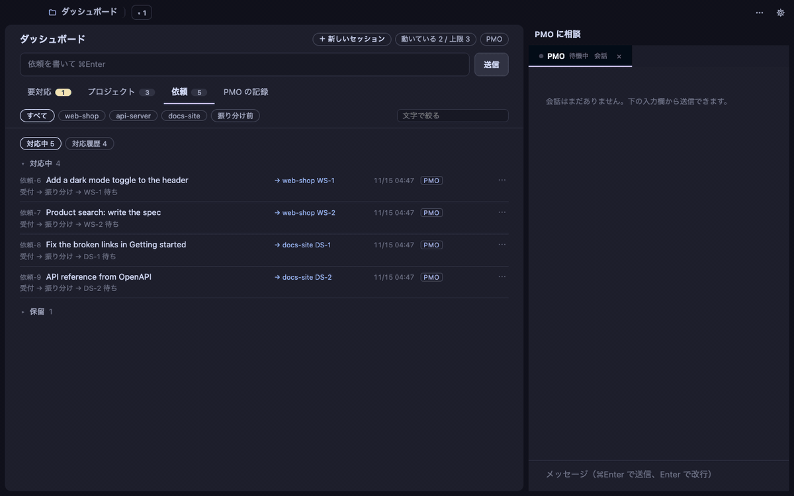
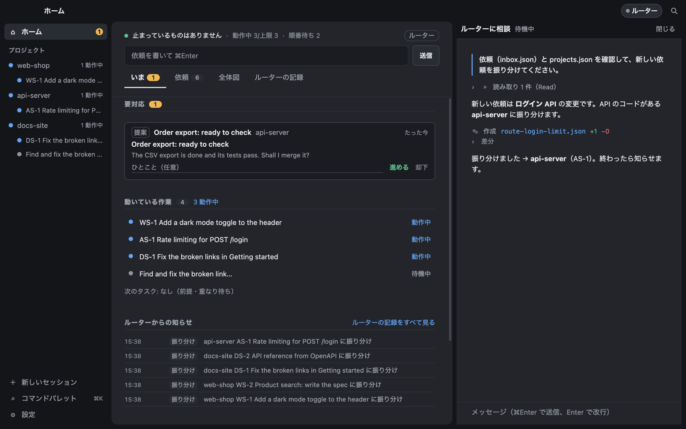
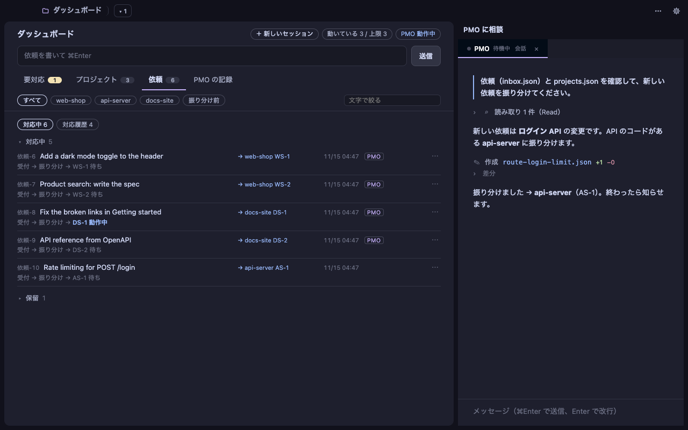
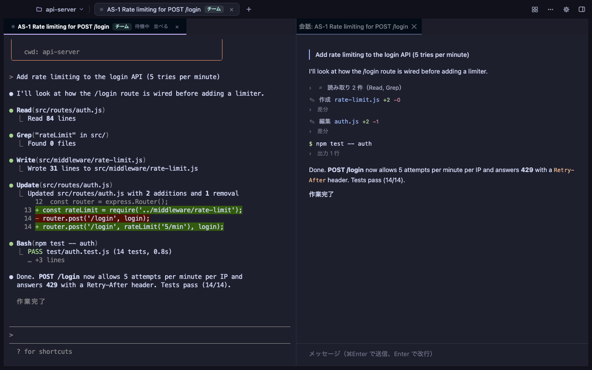

<h1 align="center">BantoDesk</h1>

<p align="center"><i>BantoDesk — a head clerk (番頭, <b>banto</b>) for your Claude Code sessions: the one who runs the shop while the owner is away.</i></p>

<p align="center">
  <b>Drop a request in the inbox. A manager agent routes it to the right project, and Claude Code does the work —<br>
  across many folders at once, while you are away.</b>
</p>

<p align="center">
  <a href="README.ja.md">日本語</a> ·
  <a href="#quick-start">Quick start</a> ·
  <a href="#what-you-get">Features</a> ·
  <a href="docs/security.md">Security</a>
  <br><br>
  
  
  
</p>

<p align="center">
  
</p>

<p align="center">
  
</p>

## Why

Claude Code is great at one task in one folder. Real work is ten tasks in five folders: you open terminals, paste
instructions, wait, answer a permission prompt, forget which tab was waiting for you, and come back to find that half of
the sessions stopped an hour ago.

BantoDesk is a desktop app that takes that juggling off your hands:

- **You only do three things:** give instructions, answer the questions that really need you, and pick up the results.
- **A manager agent — the "Router" (shown as ルーター in the app UI) — does the rest:** it reads every request, sends it to the right project folder,
  decides the order, asks you up front when something is ambiguous, and gets stuck sessions moving again.
- **Each folder has its own queue**, and the app starts Claude Code sessions from it — in parallel where the work does
  not overlap, within the CPU and memory you have.

## What you get

| Feature | What it does |
|---|---|
| 📥 **Inbox** | Type or paste a request (or drop a file) at the top of the dashboard; the 依頼 (Requests) tab tracks each one. Nothing is lost: it stays until it is routed. |
| 🧭 **Router agent** | A Claude Code session that manages the others: routes requests to folders, orders the queues, writes up-front Q&A with its own best guess (leave it blank to accept), nudges stuck sessions and answers permission prompts that are safe. |
| 🗂 **Per-folder queues** | Requests become work items in each project. Items that touch different files run in parallel; a global limit (default 3) and resource checks keep the machine responsive. A session reports `作業完了` (done) or `作業中断` (stopped) and the next item starts. |
| 💬 **Session windows** | One window per folder, one tab per Claude Code session. A conversation view (Markdown, tool calls, folded diffs, subagents and Agent Teams members) with the real terminal one click away. |
| 📊 **Dashboard** | Every folder, queue and session at a glance. "要対応" (Needs you) collects the questions, proposals and permission prompts waiting for you — answer them in place, even for windows that are hidden. |
| 🔁 **Keeps going by itself** | Sessions near a full context hand over to a fresh one with a memo; heavy sessions restart with `--resume`; idle ones rest and wake up when needed; finished folders get an automatic review that proposes next steps. |
| 🧰 **Everyday tools** | Viewer for Markdown / HTML / images / PDF / Excel, temporary sessions, a single-file edit mode, snippets and history in the composer, notifications and sounds, keep-awake while work runs, and an optional phone view on your LAN. |

## Screenshots

<p align="center">
  
  <br><b>Dashboard</b> — every project with its running session and queue (3 running, limit 3); the Router explains its routing on the right.
</p>

<table>
  <tr>
    <td width="50%"></td>
    <td width="50%"></td>
  </tr>
  <tr>
    <td align="center"><b>Requests</b> — each one is received, routed, and tracked to its folder and item</td>
    <td align="center"><b>Session window</b> — the real terminal next to a readable conversation view</td>
  </tr>
</table>

> The user interface and the built-in prompts are currently in **Japanese**. English UI text is on the wish list —
> contributions are welcome.
>
> The demo and screenshots were recorded with a scripted stand-in for Claude Code and sample projects, so they run the
> same way every time; the app, the routing and the queues in them are the real thing.

## Quick start

### Requirements

- [Claude Code](https://docs.claude.com/en/docs/claude-code), installed and signed in (`claude` works in a terminal).
  The Router and every session are ordinary Claude Code processes under your own account and plan.
- [Node.js](https://nodejs.org/) 20 or later and Git.
- macOS (Apple silicon or Intel) or Windows 10/11 (x64). Linux is untested.

### macOS

```sh
git clone https://github.com/bridgeui/bantodesk.git
cd bantodesk
npm ci
npm start                     # opens the dashboard
npm start -- ~/work/my-app    # or open a project folder directly
```

Claude Code is looked up on your `PATH` and in the usual install places (`~/.local/bin`, `~/.claude/local`,
`~/.npm-global/bin`, `~/.bun/bin`), so it is found even when the app is started from Finder or the Dock.

### Windows

```powershell
git clone https://github.com/bridgeui/bantodesk.git
cd bantodesk
npm ci
npm start
```

`node-pty` ships prebuilt binaries, so no compiler is needed. Claude Code (`claude.exe`) is started directly — not
through PowerShell or `cmd`.

> Windows support is still being verified: the bundled native module (`src/main/native/atproc.node`) has not yet
> been re-checked on Windows for this first public release. Please report problems in the issues.

### First steps

1. Start the app. The dashboard opens; the Router gets its own folder inside the app's data directory.
2. Add the project folders you work on (the "new session" panel, or `npm start -- <folder>`).
3. Write a request in the inbox — for example *"web-shop: add a dark mode toggle to the settings page"* — and watch the
   Router route it and a session pick it up.
4. When something needs you, it shows up under **要対応** ("needs you") on the dashboard.

> Every session and the Router use your Claude Code usage. The Router patrols on an interval you can change in the settings.

## How it works

```text
you ──► inbox ──► Router (Claude Code) ──route──► <folder>/ queue ──► Claude Code session ──► 作業完了 / 作業中断
                     ▲                                                    │
                     └──────── questions · proposals · stuck sessions ◄───┘
```

- The Router talks to the app through small JSON files (an *outbox*): `route`, `create`, `reorder`, `qa`, `notice`,
  `answer`, `nudge`. The app checks every one before acting on it.
- Sessions can propose follow-up work the same way (`.agent-terminal/outbox/` in the project folder); proposals come
  back to the Router, never straight into a queue.
- Progress per folder can be kept in a `PROGRESS.md` table that the dashboard reads.
- Everything runs locally. The app has no server and no telemetry.

### The former name in identifiers

BantoDesk was developed under the working name `agent-terminal`. The identifiers now use `bantodesk` (the app's data
directory, the per-project folder `.bantodesk/`, the package name). Data from earlier versions is carried over:

- on first launch, the former data directory (`agent-terminal` under your user's application data) is copied to the new
  one; the former one is left in place, never deleted;
- the former per-project folder `.agent-terminal/` is still read (nothing new is written there);
- if only the former default work folder `Agent Terminal` exists in your Documents folder, it stays the default (work
  folders are not moved).

The former name remains only in environment variables starting with `AGENT_TERMINAL_`, the e2e test marker
`--agent-terminal-e2e`, and the fallback power-request name inside the native module source (`native/atproc/atproc.c`;
the app always passes "BantoDesk"). They are the same app; nothing needs to be done.

## Security

BantoDesk runs agents unattended, so it is designed to never behave like malware and to keep agents inside guard
rails:

- no run-time compilation, no hidden script engines, no process or network scanning, no credential access, no
  autostart entries — process information comes from a small bundled native module that reads only PIDs and memory;
- every Claude Code process it starts gets deny rules and a `PreToolUse` hook that stop risky command shapes
  (inline interpreter code that starts processes, encoded commands, `curl | sh`, …) and tell the agent how to rewrite
  them;
- the Router only ever presses a one-time "Yes" on prompts the app classifies as safe; deletions, secrets, network access
  and paths outside the folder always go to you;
- remote debugging is refused unless it is a test run bound to `127.0.0.1`.

Read the full [security design](docs/security.md). Please report vulnerabilities privately through GitHub's
"Report a vulnerability".

## Development

```sh
npm test          # unit tests (plain node, no Electron)
npm test -- waits # only test folders whose name contains "waits"
```

See [CONTRIBUTING.md](CONTRIBUTING.md).

## License

[MIT](LICENSE) © 2026 BridgeUI

BantoDesk is an independent project and is not affiliated with or endorsed by Anthropic. "Claude" and
"Claude Code" are trademarks of Anthropic.
